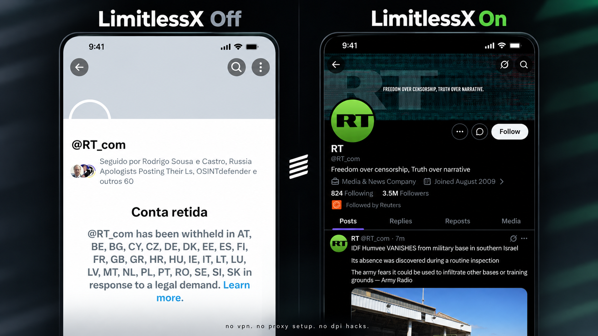
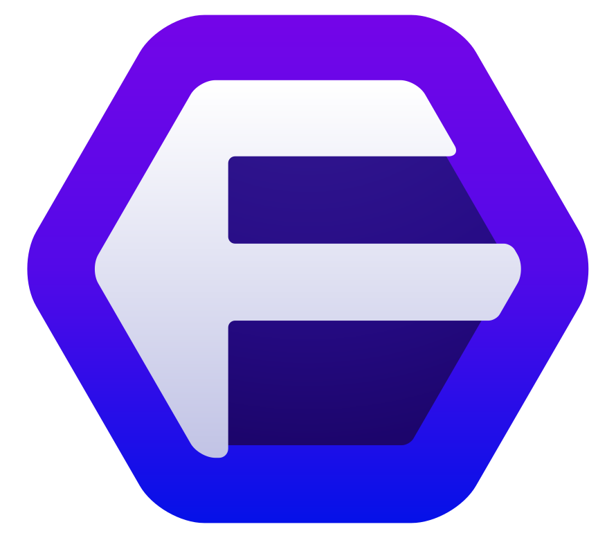

<picture>
  <source media="(prefers-color-scheme: dark)" srcset="docs/brand/mark-dark.svg">
  
</picture>

# LimitlessX

**No VPN. No proxy setup. No DPI hacks.**

A browser extension for viewing region-restricted public profiles and posts on X (Twitter).

## Download

| Chrome, Helium, Brave, Edge, Opera, Vivaldi | Firefox, Zen, LibreWolf, Floorp, Waterfox |
| :---: | :---: |
|       |      |
| [**Download ZIP**](https://github.com/OnurByte/LimitlessX/releases/latest/download/limitlessx-chromium.zip) | [**Download ZIP**](https://github.com/OnurByte/LimitlessX/releases/latest/download/limitlessx-firefox.zip) |

**Chrome and related browsers:** extract the ZIP, open the Extensions page, enable **Developer mode**, then **Load unpacked** and select the extracted folder.

**Firefox and related browsers:** extract the ZIP, open `about:debugging` → **This Firefox** → **Load Temporary Add-on**, then select `manifest.json`. This unsigned add-on must be loaded again after restarting Firefox.

## Usage

Open a region-restricted profile or post on X. The extension loads the public content automatically. Scroll to load more posts, or enter an `@handle` or X URL in the extension popup.

Content is fetched through [FxTwitter](https://github.com/FxEmbed/FxEmbed), so some profiles or posts may be unavailable. Private accounts are not supported. The extension does not collect X credentials or analytics; viewing counts are stored locally.

[Privacy](docs/privacy.md) · [Browser compatibility](docs/compatibility.md) · [Build from source](docs/build.md) · [Architecture](docs/architecture.md) · [Tests](.github/workflows/check.yml)
